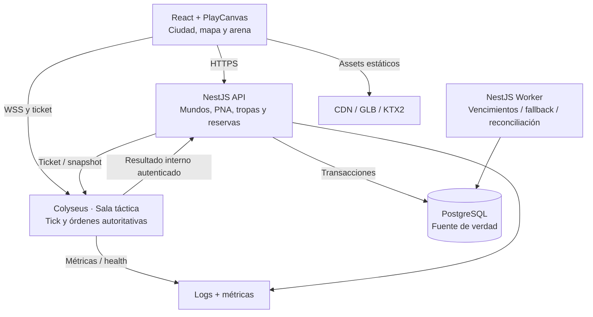
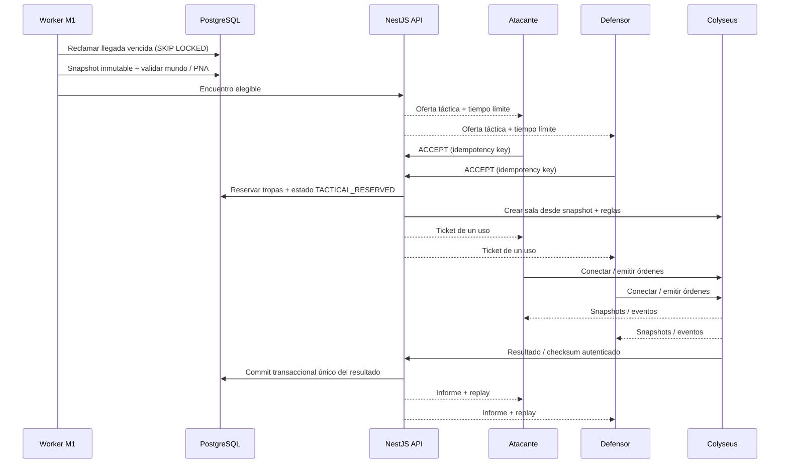
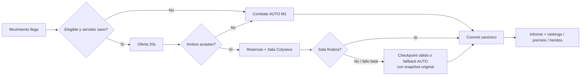

# Arquitectura y flujos de integración — MVP 2

Esta es una **arquitectura objetivo**, no una representación de servicios ya desplegados.

## 1. Vista de componentes

**Propiedad de datos:** `battle-server` únicamente puede leer snapshot autorizado y enviar resultado. Las operaciones críticas sobre tablas M1 se hacen desde API/worker, dentro de transacciones PostgreSQL. El API controla capacidad, admisión y estado de encuentro.

## 2. Secuencia de ataque con ambos usuarios conectados

## 3. Secuencia de defensa offline / falla Colyseus

**Clave de integridad:** no generar dos paths con dos commits, aunque el servidor táctico y el worker compitan. `battle_encounters.version` y `tactical_results.encounter_id` identifican estado/resultado.

## 4. Seguridad de fronteras

- **Web → API:** sesión del jugador ya existente en MVP 1; autorización por mundo/rol y protección CSRF aplicable.
- **API → Colyseus:** ticket de un uso, audiencia y TTL cortos; creación de sala solo por backend autorizado.
- **Web → Colyseus:** `order` es una intención, no una actualización directa del estado.
- **Colyseus → API:** endpoint interno con autenticación de servicio, red interna y verificaciones de checksum/encounter/version.
- **API → DB:** única propiedad del resultado del mundo; políticas de aislamiento de mundos.
- **CDN → Web:** solo recursos versionados con manifest/licencias; CSP y CORS configurados.
- **Blender MCP / herramientas IA:** nunca accesibles desde el juego público.

## 5. Regiones y escalado futuro

En el primer despliegue, usar un VPS que aloje procesos API, worker, PostgreSQL y `battle-server` si benchmarks lo permiten. Separar `battle-server` a otra máquina **solo** cuando interfiera con API/DB o haya suficiente demanda. Desplegar preferentemente en región cercana a los jugadores; medir latencia antes de decidir.

Si se supera un único proceso Colyseus, revisar los componentes oficiales de presence y matchmaking driver compartidos (y recién ahí un Redis/Valkey si se justifica). Esta decisión requiere benchmark, presupuesto y ADR nueva.

## 6. Invariantes de negocio transversales

1. Rechazar PNA y atacante que no pertenezca al mundo.
2. No usar un ejército ya comprometido en otro ataque/sala.
3. No permitir dos resultados aplicados para el mismo `movement_id`/`encounter_id`.
4. Rechazo de invitación nunca produce pérdida adicional.
5. No otorgar recompensas semanales por simplemente aceptar una batalla táctica.
6. Maravilla y cierre de temporada no dependen de salas en vivo.
7. `TRAINING` no escribe en `resource_ledger`, `troop_stacks` ni `ranking_snapshots`.
