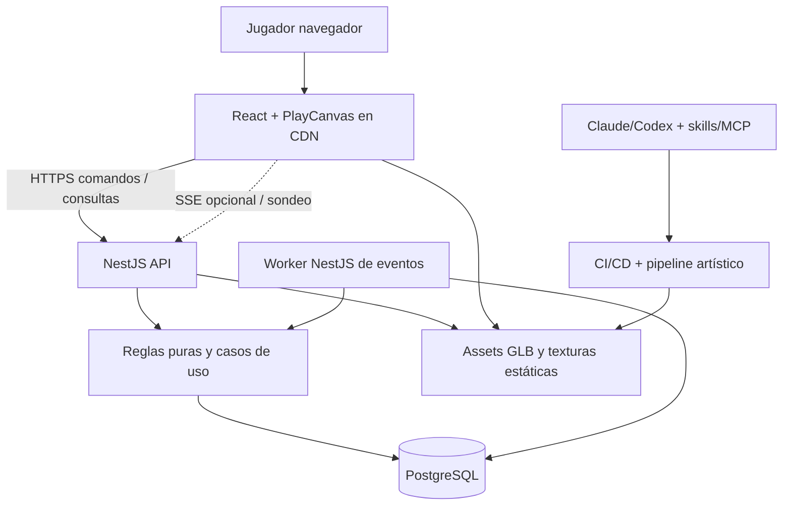
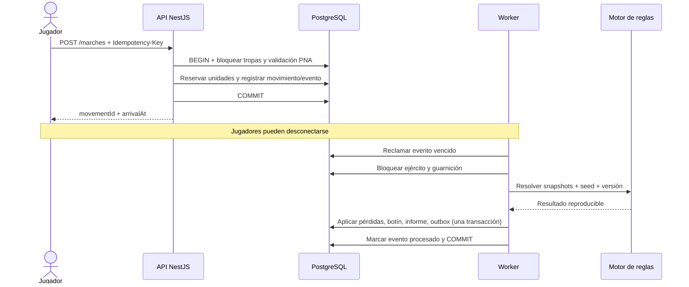
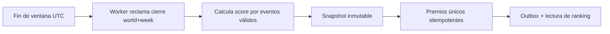
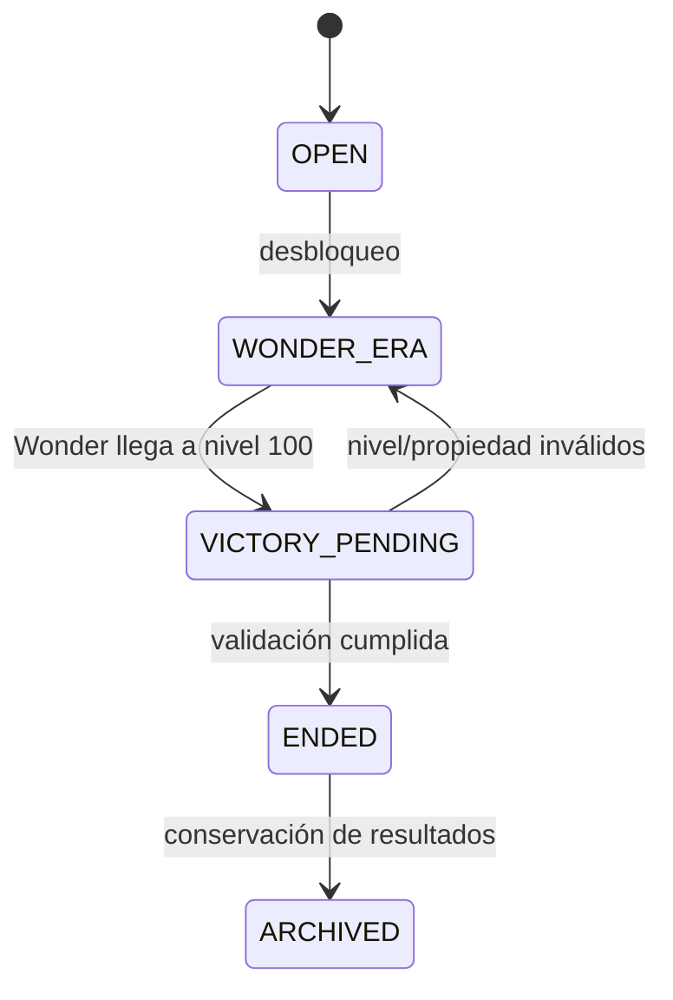

# Arquitectura y ADR — Reinos de la Frontera — MVP 1.0

**Estado global:** Aprobación propuesta para implementación · **Fecha:** 2026-11-03  
**Convención:** ADR = contexto → decisión → alternativas → consecuencias → disparador de revisión. Las decisiones son propuestas técnicas justificadas, no infraestructura ya desplegada.

---

## 1. Contexto arquitectónico y principios

Un juego MMORTS de mundo persistente parece necesitar una infraestructura masiva, pero el MVP solo requiere que **las reglas sean autoritativas, temporalmente correctas y recuperables**. Los navegadores representan ciudades, regiones y batallas; el servidor conserva el estado, valida los comandos y procesa movimientos, producción y eventos. Hay distintas escalas de tiempo: acciones web inmediatas, eventos de minutos/horas, cierres semanales y temporadas completas.

Principios innegociables:
1. **Una única fuente de verdad:** PostgreSQL; no queda progreso competitivo únicamente en memoria.
2. **Aislamiento por mundo:** identidad de mundo en todas las entidades y autorizaciones.
3. **Tiempo de servidor:** relojes de usuario nunca determinan resultados.
4. **Integridad antes que rendimiento:** transacciones, orden de eventos, idempotencia y auditoría.
5. **Cliente no autoritativo:** el 3D es representación, no simulador de economía ni juez militar.
6. **Complejidad justificada:** añadir procesos y servicios cuando existan métricas que lo demanden.
7. **IA en desarrollo, no en partida:** ningún jugador requiere inferencias pagadas para jugar.
8. **Versionado de reglas:** las temporadas y batallas históricas mantienen reglas reproducibles.
9. **Contenido artístico validado:** generar con IA no implica publicar sin QA.

## 2. Arquitectura de contenedores



**MVP desplegado:** (1) frontend estático, (2) API NestJS, (3) worker Node independiente, (4) PostgreSQL, (5) almacenamiento estático/CDN. Worker y API pueden ejecutarse en un mismo VPS como procesos separados. No requiere Valkey, BullMQ, Kafka, Kubernetes, Colyseus ni GPU en producción.

### 2.1 Monorepo propuesto

```text
reinos-de-la-frontera/
├── apps/
│   ├── web/              # PlayCanvas React + Vite
│   ├── api/              # NestJS, API, autenticación
│   └── worker/           # Scheduler PostgreSQL y outbox
├── packages/
│   ├── game-rules/       # Economía, combate, mundo, victoria (sin NestJS)
│   ├── contracts/        # Zod/DTO/OpenAPI y eventos
│   ├── catalog/          # Civilizaciones, unidades, edificios, balance
│   ├── db/               # Drizzle, SQL y migraciones
│   └── asset-contracts/  # Manifiestos y validaciones 3D
├── assets/
│   ├── source/           # .blend y fuentes autorizadas
│   ├── processed/        # GLB optimizado, texturas, LOD
│   └── manifests/
├── infra/
│   ├── compose.yaml
│   └── caddy/
├── docs/
│   ├── PRD-MVP1.md
│   ├── ADR-MVP1.md
│   └── AI-SETUP-MVP1.md
└── AGENTS.md
```

## ADR-001 — Monolito modular de NestJS frente a microservicios

**Estado:** Aceptado para MVP1.  
**Contexto:** Economía, ejércitos, tratados, Maravillas y premios comparten transacciones y cambios de propiedad.  
**Decisión:** un NestJS modular con módulos `identity`, `worlds`, `villages`, `economy`, `military`, `naval`, `npc`, `diplomacy`, `rankings`, `awards`, `wonders`, `admin`. Lógica central aislada en `packages/game-rules`. Worker como proceso del mismo repositorio.  
**Alternativas:** microservicios por dominio, funciones serverless.  
**Consecuencias:** menos despliegues, latencia, costos y consistencia distribuida; se requieren límites de módulos, tests y DTO explícitos.  
**Revisar cuando:** despliegue autónomo de un dominio aporte valor medido, no por moda arquitectónica.

## ADR-002 — Cliente 3D PlayCanvas React y UI React

**Estado:** Aceptado.  
**Contexto:** browser-first con TypeScript y visual de calidad realista estilizada.  
**Decisión:** `@playcanvas/react` + PlayCanvas Engine + Vite + React. UI DOM para controles; render 3D para ciudades, mapa y replay.  
**Alternativas:** Three.js/R3F (flexible pero más ensamblaje), Babylon.js (válido), Godot/Unity export web (mayor complejidad de build/runtime para este caso).  
**Consecuencias:** pipeline web nativo, skills oficiales, editor opcional; imponer budgets de performance y compatibilidad.  
**Revisar cuando:** se pruebe incapacidad técnica concreta de renderizar escenas objetivo.

## ADR-003 — PostgreSQL como único datastore persistente

**Estado:** Aceptado.  
**Contexto:** economía, movimientos y premios necesitan transacciones confiables.  
**Decisión:** PostgreSQL como fuente de verdad; no MongoDB, Redis ni otro almacén obligatorio. Usar Drizzle ORM para esquema y migraciones, SQL explícito para bloqueos e invariantes críticos.  
**Alternativas:** bases por microservicio, Redis-first, event sourcing completo.  
**Consecuencias:** operaciones sencillas; todas las escrituras concurren en un motor robusto. Requiere índices, locks cortos y política de backup.  
**Revisar cuando:** latencias o throughput de consultas medidos muestren necesidad de caché/replicación.

## ADR-004 — Multiworld por aislamiento lógico con `world_id`

**Estado:** Aceptado.  
**Contexto:** cada servidor/temporada debe ser independiente, sin pagar VPS por mundo.  
**Decisión:** esquema compartido con `world_id` obligatorio, índices y FKs compuestas que impidan asociaciones cruzadas; `world_players` desacopla `accounts`. Servicios siempre resuelven contexto de mundo autorizado.  
**Alternativas:** base por mundo, esquema PostgreSQL por mundo, VPS por mundo.  
**Consecuencias:** bajo costo y mantenimiento reducido; riesgo cross-world mitigado con test automático y constraints.  
**Revisar cuando:** aislamiento operativo/legal, escala o migración geográfica demanden DB por mundo.

## ADR-005 — Eventos futuros en PostgreSQL, sin BullMQ/Valkey inicial

**Estado:** Aceptado.  
**Contexto:** miles de construcciones, reclutamientos y ataques programados, con recuperación tras reinicios.  
**Decisión:** tabla `scheduled_events(id, world_id, type, due_at, status, attempts, payload, last_error, created_at, processed_at)` con worker que usa `FOR UPDATE SKIP LOCKED` y lotes. El procesador consulta estado actual, valida el evento y aplica cambios + marca procesado en **una transacción**. Reconciliador reintenta vencidos.  
**Alternativas:** cron por aldea (no), BullMQ/Valkey (útil a escala), Kafka (innecesario).  
**Consecuencias:** menos infraestructura. Necesita índices por vencimiento, límites de batch, fairness entre mundos y monitoreo de retraso.  
**Revisar cuando:** atraso p95 de eventos y/o contención de DB excedan objetivos; entonces evaluar BullMQ/Valkey o cola PostgreSQL especializada.

### Algoritmo de procesamiento conceptual

```sql
BEGIN;
SELECT id, world_id, type, payload
FROM scheduled_events
WHERE status = 'PENDING' AND due_at <= now()
ORDER BY due_at, id
FOR UPDATE SKIP LOCKED
LIMIT 100;
-- Para cada evento, bloquear filas de negocio afectadas en orden estable,
-- validar estado, aplicar cambios idempotentes y marcar PROCESSED.
COMMIT;
```

**Cuidado de implementación:** `FOR UPDATE SKIP LOCKED` solo reclama filas durante la transacción. Si el procesamiento es largo, separar `claim` mediante `status=PROCESSING`, `lease_until`, `claim_token` y heartbeats, con recuperación de leases; el claim y su transición deben ser atómicos. No ejecutar tareas externas lentas bajo locks prolongados.

## ADR-006 — Transactional outbox e idempotencia por comando/evento

**Estado:** Aceptado.  
**Contexto:** caídas entre commit y notificación o reintentos de HTTP pueden duplicar efectos.  
**Decisión:** `Idempotency-Key` persistida por `account_id + world_id + endpoint/command` junto con hash de payload y respuesta; outbox insertado en misma transacción de negocio; publicador reintenta entregas. Las acciones se diseñan para reejecución segura.  
**Alternativas:** exactamente-una-vez en cola, confiar en cliente, transacciones distribuidas.  
**Consecuencias:** más tablas y disciplina, pero consistencia frente a reinicios.  
**Revisar cuando:** nunca retirar sin mecanismo superior probado.

## ADR-007 — Economía lazy con enteros de precisión fija

**Estado:** Aceptado.  
**Contexto:** actualizar cada mina por segundo desperdicia CPU.  
**Decisión:** `balance`, `rate_per_ms` racional/fijo, `last_settled_at`, `fraction_remainder`, `capacity`; liquidar antes de cada operación y cambio de tasa. Orden temporal determinista para consumo de alimentos.  
**Alternativas:** ticks globales, cálculo en navegador.  
**Consecuencias:** casi cero trabajo entre accesos, pero las fórmulas requieren pruebas de precisión, límites, cambios de producción y carreras.  
**Revisar cuando:** reglas futuras necesiten múltiples eventos de producción intermedios; seguir siendo autoritativo.

## ADR-008 — Motor de combate puro, versionado y determinista

**Estado:** Aceptado.  
**Contexto:** resolver ataques offline y auditar resultados.  
**Decisión:** función `resolveBattle(input, seed, rulesetVersion)` en `packages/game-rules`, sin dependencias de DB o 3D; snapshots completos; PRNG sembrado determinista controlado y orden de operaciones estable.  
**Alternativas:** cálculos en cliente, IA generativa en combate, física persistente.  
**Consecuencias:** reproductibilidad, pruebas masivas y balance; las repeticiones 3D son dramatizaciones de un resultado conocido.  
**Revisar cuando:** incorporar módulo de combates tácticos requiere otro motor autoritativo, pero conservar contratos comunes de unidades y snapshots.

## ADR-009 — Batalla táctica en tiempo real fuera de MVP1

**Estado:** Aceptado.  
**Contexto:** la guerra persistente no debe exigir defenderse en directo.  
**Decisión:** MVP1 incluye combate automático, doctrina de defensa offline, informe y replay 3D. MVP2 podrá incluir duelos tácticos consentidos con Colyseus.  
**Alternativas:** RTS obligatorio, ventanas de defensa sin reglas offline.  
**Consecuencias:** reduce enorme complejidad de simulación, sincronización y latencia.  
**Revisar cuando:** economía y guerra asíncrona estén estables y un prototipo táctico tenga tests de desconexión.

## ADR-010 — Mundo lógico en cuadrícula; visualización 3D por regiones

**Estado:** Aceptado.  
**Contexto:** mapa grande con mares, islas y oasis; no se necesita un mesh continuo de todo el universo en backend.  
**Decisión:** cuadrícula discreta con atributos y grafo de navegación; cliente convierte regiones visibles en mallas/instancias 3D. Alturas, costas y biomas generados desde semilla y persistidos.  
**Alternativas:** vóxeles/cubos visibles, físicas 3D server-side de mundo completo.  
**Consecuencias:** rutas deterministas y bajo consumo. El aspecto visual puede ser continuo/suave aunque la lógica use tiles.  
**Revisar cuando:** necesidades de navegación más compleja justifiquen grafos adicionales.

## ADR-011 — Transporte naval estratégico y sin física server-side

**Estado:** Aceptado.  
**Contexto:** barcos, océanos e islas significativos sin crear un simulador de navegación.  
**Decisión:** conexiones de agua navegable + puertos, cálculo de trayecto y hora de llegada, capacidad reservada, movimiento modelado como evento.  
**Alternativas:** simulación de cuerpos rígidos y barcos en backend, teleport por URL.  
**Consecuencias:** navegación y comercio reales con costo pequeño; batalla naval aplazada.

## ADR-012 — NPC con máquinas de estado y reglas/eventos

**Estado:** Aceptado.  
**Contexto:** aldeas anárquicas activas incluso sin jugadores conectados.  
**Decisión:** FSM + utilidad/heurísticas controladas por parámetros; eventos diferidos, límites de ataques y seed determinista cuando haya azar.  
**Alternativas:** consultas LLM para cada NPC, simulación continua por tick.  
**Consecuencias:** económico, auditable, ajustable. Narrativas generadas por IA podrán ser contenido **precalculado**, no lógica.

## ADR-013 — Diplomacia contractual: PNA y confederación

**Estado:** Aceptado.  
**Contexto:** tratados deben tener efecto tangible, no solo etiqueta.  
**Decisión:** PNA bloqueará **nuevos ataques** hasta término/cooldown; activación impide que existan ataques hostiles pendientes; confederación limitada inicialmente a 3 alianzas por mundo; membresías versionadas en tiempo para scores.  
**Alternativas:** promesa social sin validación, confederación ilimitada.  
**Consecuencias:** reglas claras, menos traición instantánea; límites deberán reevaluarse con datos competitivos.

## ADR-014 — Rankings y premios con snapshots históricos

**Estado:** Aceptado.  
**Contexto:** premios semanales vulnerables a duplicación y manipulación por cambio de alianza.  
**Decisión:** ledger de eventos de puntuación, acumuladores consultables, cierre semanal UTC por snapshot inmutable, concesión transaccional. Premios cosméticos/honoríficos, no poder.  
**Alternativas:** calcular desde estado actual, ranking solo en caché, premios económicos.  
**Consecuencias:** auditoría y equidad; más almacenamiento de eventos, reducible por partición/retención aprobada.

## ADR-015 — Victoria por Maravilla nivel 100 con validación

**Estado:** Aceptado.  
**Contexto:** competición estacional necesita cierre inequívoco y resistente a empates/carreras.  
**Decisión:** `world.state` y `wonder.level` se actualizan bajo locks; al llegar a 100 entra en validación (ej. 24 h), la candidatura puede anularse, la victoria se confirma una sola vez y sella el mundo.  
**Alternativas:** primera solicitud de nivel 100 gana inmediatamente, revisión administrativa manual.  
**Consecuencias:** batalla final dramática y control transaccional más complejo. Probar cronología de dos maravillas simultáneas.

## ADR-016 — Assets originales, IA offline + Blender + GLB

**Estado:** Aceptado.  
**Contexto:** calidad visual sin estudio 3D grande ni inferencia durante el juego.  
**Decisión:** concept art consistente → IA 3D local/externa → revisión geométrica Blender → UV/PBR → rig/animación → LOD/compresión glTF → screenshot en motor → aprobación. Assets se guardan con fuentes/licencias/manifest.  
**Alternativas:** assets de cubos, generación en tiempo real en cliente, depender de un único proveedor cerrado.  
**Consecuencias:** inversión inicial en pipeline y QA; costo de juego bajo y assets reutilizables. El 100% de automatización sin revisión no es un requisito de calidad realista.

## ADR-017 — Autenticación por sesiones opacas y permisos en backend

**Estado:** Aceptado.  
**Contexto:** protección de cuentas y recursos en navegador.  
**Decisión:** credenciales con Argon2id, sesiones opacas revocables en cookie `HttpOnly; Secure; SameSite`, CSRF, rate limiting, controles de origen, autorización en cada comando y auditoría de administración.  
**Alternativas:** JWT en localStorage, estado de autorización solo frontend.  
**Consecuencias:** tabla de sesiones y rotación; facilidad de revocar cuentas. Correo de recuperación/verificación requerirá servicio externo antes de beta pública.

## ADR-018 — Eventos hacia cliente por consulta y SSE opcional

**Estado:** Aceptado.  
**Contexto:** MVP no necesita sincronizar posiciones de cientos de unidades en tiempo real.  
**Decisión:** HTTP para comandos/lecturas, actualizaciones de estado cada 15–30 segundos según pantalla, SSE opcional para alertas y cuenta regresiva desde reloj del servidor.  
**Alternativas:** WebSocket obligatorio/Colyseus desde día 1.  
**Consecuencias:** implementación sencilla y menos conexiones críticas; posterior combate táctico añadirá canal dedicado.

## ADR-019 — Despliegue simple con Docker Compose, un VPS y CDN

**Estado:** Aceptado.  
**Contexto:** minimizar pagos mensuales y coste operativo.  
**Decisión:** frontend estático en CDN; VPS Linux con Caddy + API + worker + PostgreSQL mediante Compose; volúmenes y backup fuera del VPS; monitoreo mínimo. Assets estáticos junto a frontend si cabe, R2 u objeto externo cuando convenga.  
**Alternativas:** Kubernetes/AKS, microservicios serverless, GPU remota.  
**Consecuencias:** punto único de fallo y escalado vertical; apropiado solo para piloto/alfa con restore probado.  
**Revisar cuando:** caída/mantenimiento, carga o disponibilidad exijan DB gestionada, réplica o separación por mundo.

## ADR-020 — Testing multicapa y balance basado en simulación

**Estado:** Aceptado.  
**Contexto:** bugs de economía, defensa o clasificación generan pérdidas de confianza.  
**Decisión:** Vitest para dominio, integración con PostgreSQL real, Playwright E2E, simulaciones property-based/balance de miles de batallas y snapshots de escenas 3D. Load tests antes de beta.  
**Alternativas:** solo pruebas manuales, tests de unidades sin DB.  
**Consecuencias:** desarrollo más lento al comienzo, menos regresiones y agentes verificables.

## ADR-021 — Seguridad de agentes, MCP y licencias

**Estado:** Aceptado.  
**Contexto:** MCP de modelado puede ejecutar Python y los modelos IA tienen licencias distintas.  
**Decisión:** agentes en entorno de desarrollo con permisos mínimos; nunca desplegar credenciales de producción ni secretos a MCP; revisar comandos antes de ejecutar scripts remotos; dependencia/asset con origen y licencia en manifiesto; revisión humana antes de publicar.  
**Alternativas:** dar acceso administrativo ilimitado y publicar todos los resultados automáticos.  
**Consecuencias:** controles de aprobación y trazabilidad de assets, esenciales para producción comercial.

## ADR-022 — Balance y reglas como datos versionados

**Estado:** Aceptado.  
**Contexto:** costes, estadísticas y tecnologías cambian por playtesting; una temporada no debe perder coherencia.  
**Decisión:** catálogo YAML/JSON validado por schemas, versionado con git y persistencia `ruleset_version` por mundo; hotfixes cuidadosamente migrados, con reportes reproducibles.  
**Alternativas:** constantes dispersas, cambios directos a tablas sin versión.  
**Consecuencias:** simuladores pueden probar cambios antes de aprobarlos; editor visual de balance queda para futuro.

## ADR-023 — Backups, migraciones y operación segura

**Estado:** Aceptado.  
**Contexto:** pérdida de datos competitivos destruye una temporada.  
**Decisión:** migraciones versionadas, backup automático cifrado y externo, restauración ensayada, healthchecks, logs JSON, métricas de atraso y runbook de incidentes.  
**Alternativas:** snapshots ad hoc, backups dentro del mismo VPS.  
**Consecuencias:** algún costo de almacenamiento y tareas operativas; no se publica sin recuperación comprobada.

## ADR-024 — Moderación y protección antiabuso como parte del sistema

**Estado:** Aceptado.  
**Contexto:** multicuenta, granjas de puntos, alianzas explotadoras y ataques a nuevos jugadores pueden arruinar el mundo.  
**Decisión:** protección inicial configurable, detección gradual de abuso, auditoría de puntuaciones, sanciones con trazabilidad y panel de operaciones con mínimo privilegio.  
**Alternativas:** políticas solo comunitarias sin aplicación técnica.  
**Consecuencias:** requiere reglas transparentes y revisión para evitar falsos positivos; no recolectar datos personales innecesarios.

---

## 3. Modelo de flujo y consistencia

### 3.1 Ataque offline



### 3.2 Cierre semanal



### 3.3 Confirmación de Maravilla



## 4. Matriz de riesgos técnicos

| Riesgo | Probabilidad inicial | Impacto | Mitigación/indicador |
|---|---|---|---|
| Duplicación en reintentos | Media | Crítico | Idempotencia, locks, test de fallo post-commit |
| Aislamiento por mundo | Media | Crítico | FK compuesta, filtros, fuzz de IDs |
| Desbalance militar y PNA | Alta | Alto | Simulaciones de combate, revisión de tratados |
| Mala calidad de modelos IA | Alta | Alto | QA visual, pipeline y referencias artísticas |
| Cuellos en PostgreSQL scheduler | Media | Medio | Índices, batch, lag, separar lectura si procede |
| Multiplayer excesivo en VPS | Media | Alto | Pilotaje de carga, escalado medido |
| Ataques nocturnos abusivos | Media | Alto | Protección, defensa offline, plazos balanceados |
| Licencia restrictiva de assets/modelos | Media | Alto | Inventario y revisión previa |
| Restauración sin idempotencia | Media | Crítico | Restore drill y reconciliación de eventos |

## 5. Dependencias permitidas y decisiones diferidas

| Componente | MVP1 | Cuándo agregar |
|---|---|---|
| TypeScript, NestJS, React, PlayCanvas | Obligatorio | Inicial |
| PostgreSQL + Drizzle / SQL | Obligatorio | Inicial |
| Docker Compose + Caddy | Recomendado para producción piloto | Al desplegar |
| Vitest, Playwright | Obligatorio | Inicial |
| Blender, glTF Transform | Obligatorio en pipeline artístico | Inicial |
| PlayCanvas Skills | Recomendado, incluido en scaffold | Inicial |
| Blender MCP | Recomendado para creación asistida | Según tareas |
| Playwright MCP | Recomendado para agentes QA | Inicial |
| PlayCanvas Editor MCP | Opcional: solo al usar Editor cloud | Si se adopta ese editor |
| Hunyuan3D local | Opcional: producción de assets | Cuando el pipeline sea estable |
| Meshy / Tripo | Opcional de pago | Solo si mejora resultados |
| Cloudflare R2 | Opcional | Assets grandes/descargas masivas |
| Valkey + BullMQ | **No** | Lag de scheduler/colas o carga acreditada |
| Kafka/Event Hub | **No** | Necesidad demostrada de streaming distribuido |
| Colyseus | **No** | Batallas RTS tácticas de MVP2 |
| Kubernetes | **No** | Escala/operación que lo justifique |
| LLM dentro del juego | **No** | No contemplado para reglas competitivas |

## 6. Condiciones para cambiar de arquitectura

No aceptar un cambio de arquitectura solo porque una herramienta es popular. Abrir un ADR nuevo si ocurre alguno de estos casos:
1. PostgreSQL scheduler presenta atraso sostenido por encima de SLA tras optimizar consultas y workers.
2. Escala real de jugadores supera la capacidad medida de un VPS y no basta con escalar verticalmente.
3. Combates tácticos en tiempo real demuestran requerimientos de servidor de sala y sincronización.
4. Aislamiento legal/operacional o necesidades geográficas hacen recomendable separar mundos físicamente.
5. CDN/almacenamiento de assets supera límites o costes de publicación estática.
6. Las licencias, calidad o latencia del generador 3D local impiden producción aceptable.

## 7. Checklist del arquitecto antes de implementar

- [ ] PRD y prioridades por epic aprobadas.
- [ ] Contratos y reglas versionadas antes de usar agentes en paralelo.
- [ ] Tests de mundo cruzado, gastos concurrentes y reintentos escritos.
- [ ] Worker con estrategia de claim y recuperación documentada.
- [ ] Mundo de desarrollo separado del competitivo.
- [ ] Modelo 3D real de referencia aprobado dentro de PlayCanvas.
- [ ] Licencias y procedencia de assets registradas.
- [ ] Monitoreo de atrasos, salud de PG y backups con restauración ensayada.
- [ ] Panel admin sin acceso arbitrario a comandos económicos de jugadores.
- [ ] Sin integraciones cloud opcionales configuradas con secretos locales de producción.

## 8. Fuentes técnicas oficiales

- PlayCanvas React: https://developer.playcanvas.com/user-manual/react/getting-started/installation/
- PlayCanvas Skills: https://github.com/playcanvas/skills
- PlayCanvas Editor MCP: https://developer.playcanvas.com/user-manual/editor/mcp-server/
- PostgreSQL concurrency: https://www.postgresql.org/docs/current/explicit-locking.html
- Drizzle migrations: https://orm.drizzle.team/docs/kit-overview
- BullMQ idempotent jobs (reservado para futuro): https://docs.bullmq.io/patterns/idempotent-jobs
- NestJS CLI: https://docs.nestjs.com/cli/overview
- Vitest: https://vitest.dev/guide/
- Playwright: https://playwright.dev/mcp/installation
- glTF Transform: https://gltf-transform.dev/cli
